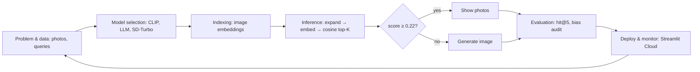

# P35 · CLIP Text-to-Photo Search — Project Report
Name: [FILL] · Roll No: [FILL] · Track C · Live app: [URL] · Repo: [URL]

## 1. Problem & goal
Search a photo collection by words or by an example image. (1 paragraph: motivation, scope, what "success" means.)

## 2. Layer I — Foundations (U1)
### 2.1 Generative vs discriminative framing
| | Discriminative | Generative |
|---|---|---|
| Models what | p(y\|x) / similarity score | p(x) or p(x\|condition) |
| In this project | CLIP (scores text–image pairs), ranking | LLM (query expansion), SD-Turbo (image fallback) |
| Output | score / ranking | new text / image |
| Failure mode | wrong ranking, bias | hallucination, unrealistic output |

### 2.2 Lifecycle diagram (redraw in your report)

### 2.3 Latent-space view
Insert screenshot of the Latent Space tab (PCA and/or t-SNE). Describe: do prompts land near matching photos?
Modality gap value: [FILL]. Observations: [FILL]

## 3. Layer II — GANs & LLMs (U2)
- Transformer at the core: CLIP text encoder (12-layer Transformer) + LLM expansion.
- Attention explanation (3–5 sentences): [FILL — how self-attention lets each token weigh others; why "chilly morning" vs expanded text yields different embeddings].
- GAN/VAE element: [FILL — contrast GAN/VAE generation with the diffusion model used in U4, 1 short paragraph].

### 3.1 Prompting techniques compared
| Technique | Example output for "chilly morning" | Hit@5 | Avg top-1 score | Notes |
|---|---|---|---|---|
| No expansion (baseline) | — | [ ] | [ ] | |
| Zero-shot expansion | [paste] | [ ] | [ ] | |
| Few-shot expansion | [paste] | [ ] | [ ] | |
| Average(original, expanded) | — | [ ] | [ ] | |

Discussion: when does expansion help, when does it hurt (hallucinated details)? [FILL]

## 4. Layer III — GPT, BERT & multimodal (U3)
- GPT-style generator: LLM (Llama 3.1 8B) · BERT-family / multimodal model: CLIP (ViT-B/32 + text Transformer).
- Image modality: yes (photos, uploaded query images).
- Index: [N] images; embedding time on CPU: [ ] s; query latency: [ ] ms.

### 4.1 Top-5 hit-rate benchmark (15 queries)
Definition: hit if any top-5 photo's caption contains the keyword. (State limitations: captions are a proxy.)

| # | Query | Keyword | Hit@5 | Hit@5 (LLM) | Top-1 score |
|---|---|---|---|---|---|
| 1 | a dog running on grass | dog | | | |
| 2 | children playing in water | water | | | |
| 3 | a man climbing a rock | climb | | | |
| 4 | snowy mountain | snow | | | |
| 5 | people on a beach | beach | | | |
| 6 | a bicycle on a road | bike | | | |
| 7 | a girl in a pink dress | pink | | | |
| 8 | a football player | ball | | | |
| 9 | a boy jumping | jump | | | |
| 10 | a black dog in the snow | snow | | | |
| 11 | a surfer on a wave | wave | | | |
| 12 | a crowd in a street | crowd | | | |
| 13 | a person on a skateboard | skateboard | | | |
| 14 | a horse | horse | | | |
| 15 | two people hiking | hik | | | |
| | **Top-5 hit rate** | | **__/15** | **__/15** | |

## 5. Layer IV — Tools & generation (U4)
- Built with PyTorch (CLIP inference) + Hugging Face Transformers; generation via SD-Turbo / Pollinations.
- Threshold choice: 0.22. Justify with data: top-1 scores of matched vs unmatched queries (table or histogram): [FILL]
- Fallback test: 3 out-of-collection queries (e.g., "a dragon over a castle") → top-1 score, generated image, quality remarks: [FILL]

## 6. Layer V — Responsible AI (U5)
### 6.1 Bias audit
Setup: [N] FairFace portraits; queries: a doctor, a nurse, a software engineer, a criminal, a CEO, a teacher; Top-N = [20].

| Query | Attribute | Most over-represented group (ratio) | Most under-represented (ratio) | Disparity max/min |
|---|---|---|---|---|
| a doctor | gender | | | |
| a nurse | gender | | | |
| a software engineer | gender | | | |
| a criminal | race | | | |

Findings (3–5 bullets, quantitative): [FILL]. Caveats: small sample, coarse labels, Top-N sensitivity (repeat for N = 10, 20, 40).
Mitigation ideas: prompt rewriting, re-ranking for diversity, showing score distributions, human review.

### 6.2 Safety guardrail & licence/IP
Describe the blocklist, test cases blocked/allowed, its limits. Licence table for data, models, generated images.

## 7. Documented failure case
- Query: [FILL] · Expected: [FILL] · Actual top-3 (screenshot) · Scores: [FILL]
- Root cause hypotheses (e.g., negation/counting weakness, small gallery, 77-token truncation, modality gap, caption-keyword proxy).
- What was tried (expansion, rephrasing) and the outcome. Proposed fix.

## 8. Deployment
Streamlit Community Cloud · Python 3.11 · secrets: `GROQ_API_KEY`, optional `HF_TOKEN` · cold-start time: [ ] s · memory: [ ] MB.

## 9. Conclusion & future work
3–5 sentences: what worked, measured results, limits, next steps (larger index with FAISS, fine-tuning, calibrated thresholds).

## References
CLIP (Radford et al., 2021) · SD-Turbo (Sauer et al., 2023) · FairFace (Kärkkäinen & Joo, 2021) · Flickr8k (Hodosh et al., 2013) · Llama 3.1.
